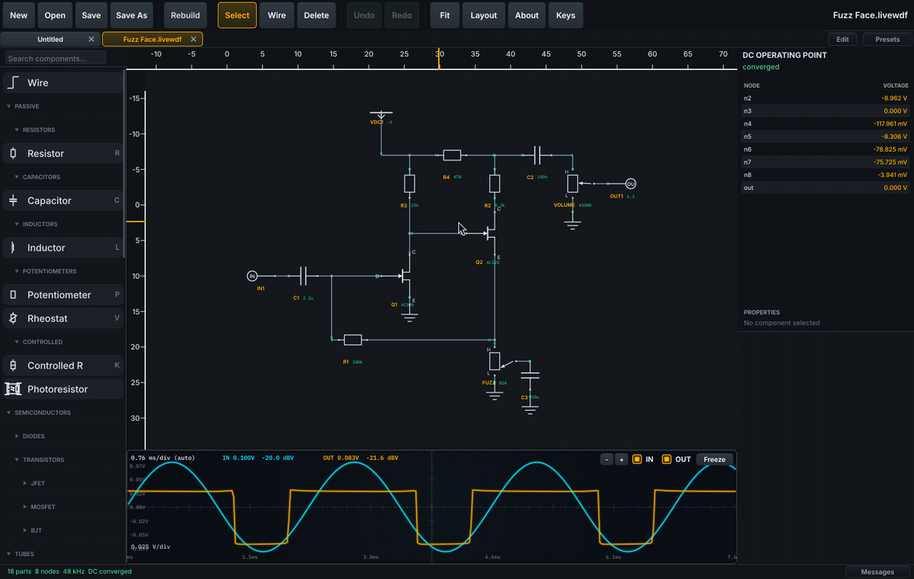

# LiveWDF

[](https://github.com/Yahiake/LiveWDF/actions/workflows/tests.yml) [](https://github.com/Yahiake/LiveWDF/actions/workflows/nightly.yml)

**An open-source, real-time Wave Digital Filter circuit simulator for audio.**

The nightly workflow builds the editor, VST3 plugin and standalone app for Windows, macOS and Linux. Find nightly builds under prereleases on [GitHub Releases](https://github.com/Yahiake/LiveWDF/releases).



LiveWDF is a C++ project focused on simulating analog audio circuits using Wave Digital Filters (WDFs). The goal is to make circuit-level simulation practical for real-time audio processing, with guitar amplifiers and effects as a primary application.

The project is being developed around three parts: a simulation engine, a circuit editor, and an audio plugin.

## What is LiveWDF?

Rather than recreating an amplifier's sound with EQ curves or neural models, LiveWDF takes a circuit-based approach. You build a circuit from its components, and the engine simulates how that circuit behaves.

The project has two main applications built around the same simulation core:

- **Circuit Editor:** Design, modify and save circuits. The idea is to work directly with components and their values, rather than being limited to a collection of fixed amplifier models.
- **Audio Plugin:** Load circuits created in the editor and run them on live audio inside a DAW.

At the center of both is the WDF engine, which handles the circuit simulation.

## Who is it for?

LiveWDF is being built with a few different audiences in mind:

- **Musicians and guitar players** who want to experiment with circuit-based amplifier and effect simulations without having to design circuits themselves. The searchable factory library includes amps, pedals, and studio circuits.
- **Circuit enthusiasts and tinkerers** who want to build their own circuits and experiment with analog components.
- **Developers and researchers** interested in Wave Digital Filters, real-time simulation, numerical methods, and audio software development.

You don't need to understand circuit theory to eventually use the plugin. But if you want to understand or contribute to the engine, some C++ and electronics knowledge will certainly help.

## Project status

LiveWDF is open source and under active development.

The C++ simulation core builds and its test suite passes. Some tests can also compare results against ngspice, when it is installed.

The editor and audio plugin are still being worked on, and their builds have not yet been fully confirmed across platforms.

**Contributions, testing, bug reports and ideas are welcome.** There is still a lot to build, and the project would benefit from people interested in working on it.

## Getting started

For now, the simulation core is the part you can build and test reliably.

### Requirements

**Windows**
- Visual Studio Build Tools with the *Desktop development with C++* workload
- CMake 3.22 or newer
- Git

**Linux**
- GCC or Clang with C++20 support
- CMake 3.22 or newer
- Git

### Clone the repository

```bash
git clone https://github.com/Yahiake/LiveWDF.git
cd LiveWDF
```

### Initialize JUCE

JUCE is used by the editor and audio plugin. It is not required to build the simulation core alone.

```bash
git submodule update --init modules/JUCE
```

### Build the core and run the tests

**Windows (PowerShell or terminal)**

```bash
cmake -S . -B build/core -DLIVEWDF_BUILD_EDITOR=OFF -DLIVEWDF_BUILD_PLUGIN=OFF -DLIVEWDF_BUILD_RENDER=OFF

cmake --build build/core --config Release --target livewdf livewdf_tests

ctest --test-dir build/core -C Release --output-on-failure
```

**Linux**

```bash
cmake -S . -B build/core -DLIVEWDF_BUILD_EDITOR=OFF -DLIVEWDF_BUILD_PLUGIN=OFF -DLIVEWDF_BUILD_RENDER=OFF -DCMAKE_BUILD_TYPE=Release

cmake --build build/core --target livewdf livewdf_tests

ctest --test-dir build/core --output-on-failure
```

The first build may take several minutes. Some tests use ngspice as an external reference simulator. They are skipped automatically when ngspice is not installed.

### LiveWDF VST3 in Carla

Carla 2.5.10's bundled JUCE VST3 host can report all circuit controls at zero in a fresh LiveWDF instance. LiveWDF's VST3 was verified with [Carla's 2.6 development backend](https://github.com/falkTX/Carla/tree/97a9e0740baf6df2df942495c02532a624c44682), which reads the initial knob values correctly.

To check your Carla build on Linux, run [the VST3 smoke test](tests/smoke/carla_vst3.py) against its backend library and the LiveWDF bundle. The smoke test uses Carla's dummy audio driver.

```bash
PYTHONPATH=/path/to/Carla/source/frontend:/path/to/Carla/source \
    python3 tests/smoke/carla_vst3.py \
    /path/to/libcarla_standalone2.so /path/to/LiveWDF.vst3
```

## Contributing

LiveWDF is still taking shape, and there's plenty of room to get involved.

Whether you're interested in the WDF engine, circuit models, numerical methods, audio processing, the editor, or plugin development, contributions are welcome.

Found a bug? Have an idea? Want to work on something? Open an issue or join the discussion.

- **GitHub:** [Yahiake/LiveWDF](https://github.com/Yahiake/LiveWDF)
- **Discord:** [Join the LiveWDF community](https://discord.gg/ZJtGJQaPWh)

## License

LiveWDF is licensed under the [GNU Affero General Public License v3.0](LICENSE) (AGPL-3.0).

Third-party dependencies and their respective licenses are listed in [THIRD-PARTY-NOTICES.md](THIRD-PARTY-NOTICES.md).
